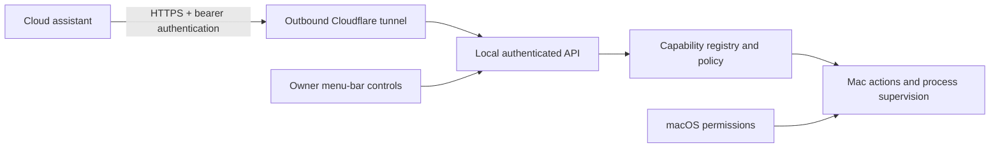

# Why Muse Mac Connector worked this way

> Written November 7, 2026. This is a retrospective explanation grounded in the current implementation and project records, not a contemporaneous decision log. It distinguishes the original need, the implemented behavior, and remaining limitations. Software implementation and current documentation were developed with AI assistance; the project direction and workflow requirements are Jordan McDonley’s.

## Historical context

Jordan built this unofficial connector before Muse released an official Mac app. It addressed the gap between a cloud assistant understanding a request and being able to act on the user’s Mac. The official Mac app subsequently made this workaround obsolete. This repository remains useful as a historical integration case study, not a recommendation to replace the official client.

## The actual integration problem

A local helper is not sufficient on its own: the assistant needs a reachable endpoint, authentication, a discoverable action contract, understandable permissions, a way to recover when connectivity changes, and a way for the owner to stop actions. Success is an authenticated request producing the intended Mac action with truthful status and visible owner control.

## Architecture

## Decisions and alternatives

| Decision | Alternative | Why it fits this project | Tradeoff / boundary |
| --- | --- | --- | --- |
| Local helper with outbound HTTPS tunnel | Router port-forwarding or an always-hosted execution service | Reaches a personally owned Mac without opening a router port or transferring execution to another machine. | Quick Tunnel URLs can change; the Mac and tunnel must be running. |
| Machine-readable capability index | Hand-written instructions for each individual task | Exposes enabled actions, parameters, confirmation requirements, and authority so an assistant can discover supported operations. | A capability description is not proof that every combination of actions works. |
| Keychain-backed bearer key | Unauthenticated local/remote API or a key embedded in source | Authentication is required on requests; the source does not need to contain a user’s credential. | A reachable tunnel still exposes a powerful endpoint; key handling remains important. |
| Conservative start with explicit Full Computer Mode | Always-on unrestricted execution | Makes the authority change explicit and gives the owner a local approval step. | Full Mode intentionally grants user-level authority; it is not a filesystem sandbox. |
| macOS remains the system boundary | Attempt to bypass OS privacy controls | Accessibility, Screen Recording, Automation, filesystem permissions, and privilege prompts remain controlled by macOS. | Onboarding and permissions can block an otherwise reachable helper. |
| Persistent process handles and output/status tools | Fire-and-forget shell commands | Builds and servers may outlive one request. Status and output are needed to know whether the requested result actually happened. | Process lifecycle, timeouts, and termination require careful verification. |
| Pause and reconnect in the menu bar | Require manual config edits or a terminal for recovery | The owner can stop new requests and refresh a changed connection without editing the service internals. | Pause is not an independent security audit or a guarantee about already-running work. |
| Visible local confirmation for obvious high-risk actions | Assume a cloud request is sufficient authorization | Keeps owner involvement for identified destructive, privileged, and credential-sensitive operations. | Heuristics cannot perfectly analyze arbitrary code; do not describe command filtering as complete isolation. |

## Validation: reported versus rerun

The public v0.5.0-alpha release notes report 24 automated operator/security/public-hygiene checks, a rebuilt packaged app, an authenticated public tunnel, and end-to-end file, chained-command, process, and app-launch acceptance. Those are recorded release claims, not a new acceptance run performed while writing this document.

See the [release record](https://github.com/dkm90x/muse-mac-connector/releases/tag/v0.5.0-alpha), [test sources](../tests), [security model](../SECURITY.md), and [Full Computer Mode contract](../FULL_COMPUTER_MODE.md). Earlier candidates had failures; a passing unit suite by itself is not evidence of packaged-app, permission-onboarding, or live-cloud integration success.

## What this demonstrates

Jordan drove the requirements for a useful computer operator: combine small actions into real workflows, retain owner control, expose actual capabilities, and report real results. AI-assisted implementation produced the connector, action registry, onboarding, packaging, and documentation. This is integration and product problem-solving evidence, not a claim of sole manual implementation or an independently audited security platform.

## Known limitations and project lesson

The published artifact is an ad-hoc-signed alpha, not an Apple-notarized production product. It is unofficial and not endorsed by Meta. Full Computer Mode is intentionally powerful. The owner must trust the connected agent and understand the actual authority granted.

The broader lesson is to solve an unmet workflow, then reassess when the platform changes. Once the official Mac app filled the original gap, maintaining a competing workaround ceased to be the primary value. Preserve the engineering evidence and make the obsolete status unmistakable.
